# Pipar user manual

How to use a Pipar keyboard day to day: the layout, the layers, and how to type Estonian letters (õ ä ö ü š ž) on Windows, macOS and Linux.

The manual covers the two full keyboards, the **Pipar Point** and the **Pipar ja Sool**. Both run [ZMK](https://zmk.dev) firmware and use the **Colemak-DH** layout.

- [Cheatsheets](#cheatsheets)
- [Set up your computer](#set-up-your-computer)
- [Typing Estonian letters](#typing-estonian-letters)
  - [Windows](#windows)
  - [macOS](#macos)
  - [Linux](#linux)
- [Pipar Point](#pipar-point)
- [Pipar ja Sool](#pipar-ja-sool)
- [Changing the keymap](#changing-the-keymap)

## Cheatsheets

Each sheet shows every layer of the keyboard. The **PC** sheets label modifiers as Win, Alt, AltGr, Ctrl and Shift. The **Mac** sheets use ⌘ ⌥ ⌃ ⇧.

| Keyboard | Colemak-DH | QWERTY |
| --- | --- | --- |
| Pipar Point | [PC](cheatsheets/pipar-point-colemak-dh-pc.svg) · [Mac](cheatsheets/pipar-point-colemak-dh-mac.svg) | [PC](cheatsheets/pipar-point-qwerty-pc.svg) · [Mac](cheatsheets/pipar-point-qwerty-mac.svg) |
| Pipar ja Sool | [PC](cheatsheets/pipar-sool-colemak-dh-pc.svg) · [Mac](cheatsheets/pipar-sool-colemak-dh-mac.svg) | [PC](cheatsheets/pipar-sool-qwerty-pc.svg) · [Mac](cheatsheets/pipar-sool-qwerty-mac.svg) |

On the sheets:

- **Yellow keys** are the Estonian letters Õ Ä Ö Ü.
- **Blue dashed keys** are US-International dead keys (`'` `"` `` ` `` `~` `^`). See [dead keys](#what-a-dead-key-is).
- **Small text at the bottom** of a key is what it does when held, for example Shift or a layer name.
- **Small text at the top** is what it does with Shift.
- **The pink key** on each layer is the thumb key you hold to reach that layer.

The sheets switch to dark colours when your system is in dark mode, and print in black on white.

> [!NOTE]
> The firmware is Colemak-DH. The QWERTY sheets show the same keymap with the letters moved to QWERTY positions, for people who remap their board. In the QWERTY version, `'` moves to the right home-row pinky key. On the Point, `;` is on the Num layer. The sheets are generated from the keymaps, so they always match the firmware. To regenerate them, run `cheatsheets/generate/generate.sh`.

## Set up your computer

The keyboard does the Colemak-DH remapping itself. **Leave your computer on a US layout.** If you also set the computer to Colemak, the letters get remapped twice and come out wrong.

For Estonian letters, use **US International** (Windows, Linux) or **ABC – Extended** (macOS). The sections below explain both.

### What a dead key is

On US International, these keys don't type anything straight away:

- `'` (apostrophe)
- `"` (Shift + `'`)
- `` ` `` (backtick)
- `~` (Shift + `` ` ``)
- `^` (Shift + 6)

They wait for the next key and combine with it: `"` then `a` gives **ä**. To type the symbol itself, press **Space** after it: `"` then Space gives a plain `"`.

This catches most people out when writing code or English text. If it bothers you, use the AltGr shortcuts below and the plain US layout. The trade-off is that AltGr then no longer types Estonian letters.

## Typing Estonian letters

### Windows

Add the layout under **Settings → Time & language → Language & region → English (United States) → Language options → Add a keyboard → United States-International**.

| Letter | Dead key | AltGr shortcut |
| --- | --- | --- |
| ä / Ä | `"` then `a` / `A` | AltGr + Q (with Shift for Ä) |
| ö / Ö | `"` then `o` / `O` | AltGr + P (with Shift for Ö) |
| ü / Ü | `"` then `u` / `U` | AltGr + Y (with Shift for Ü) |
| õ / Õ | `~` then `o` / `O` | none |
| š / Š | not available | not available |
| ž / Ž | not available | not available |

**Where AltGr is.** AltGr is Right Alt. On the Point, hold **I** (right home row) or **X** (left bottom row). On the Sool, hold **.** (full stop).

**AltGr follows the letter, not the position.** The keyboard sends the letter printed on the key, so AltGr + Q means the key labelled **Q**, wherever it sits on Colemak-DH.

**š and ž.** US International can't type these. Install [WinCompose](https://github.com/samhocevar/wincompose) and type **Compose, c, s** for š or **Compose, c, z** for ž. WinCompose also makes the Point's own [Estonian keys](#estonian-keys) work.

<!-- TODO: verify whether WinCompose on Right Alt blocks the AltGr shortcuts on US International, and document the workaround (e.g. a different compose key). -->

### macOS

Add the input source under **System Settings → Keyboard → Text Input → Edit… → + → English → ABC – Extended**. It is the only built-in input source that types all six letters without extra software.

| Letter | Keys (ABC – Extended) |
| --- | --- |
| ä / Ä | ⌥U, then `a` / `A` |
| ö / Ö | ⌥U, then `o` / `O` |
| ü / Ü | ⌥U, then `u` / `U` |
| õ / Õ | ⌥N, then `o` / `O` |
| š / Š | ⌥V, then `s` / `S` |
| ž / Ž | ⌥V, then `z` / `Z` |

**Where ⌥ (Option) is.** On the Point, hold **R** or **I**. On the Sool, hold **.** (full stop).

**Press and hold.** If key repeat is set to show accents, you can also hold a letter and pick from the pop-up: hold `s` to get š, hold `o` to get õ or ö.

**U.S. International – PC.** This input source also works and behaves like Windows, with `"` and `~` as dead keys. Like Windows, it has no š or ž.

**Copy and paste on the Point.** The Mouse layer's Cut/Copy/Paste keys send Shift+Del, Ctrl+Ins and Shift+Ins. **macOS doesn't support these.** Use ⌘X, ⌘C and ⌘V instead: hold A for ⌘, then tap X, C or V.

<!-- TODO: test every row of the table on a real Mac before publishing. -->

### Linux

Choose **English (US, intl., with dead keys)** in your desktop's keyboard settings, or run `setxkbmap us -variant intl`.

| Letter | Dead key | AltGr shortcut |
| --- | --- | --- |
| ä / Ä | `"` then `a` | AltGr + Q |
| ö / Ö | `"` then `o` | AltGr + P |
| ü / Ü | `"` then `u` | AltGr + Y |
| õ / Õ | `~` then `o` | none |
| š / ž | **Compose, c, s** / **Compose, c, z** | none |

**š and ž need a Compose key.** Turn one on, for example in GNOME Tweaks → Keyboard → Compose Key, or with `setxkbmap -option compose:menu`. On the Point, the **Menu** key is on the Fun layer: hold Del, then tap the left thumb key where Esc is.

<!-- TODO: verify the Point's unicode keys on Linux after switching mode (see below). -->

## Pipar Point

40 keys, a trackpoint on the right half, and Bluetooth to up to four devices.

### Thumb keys and layers

Each thumb key types one thing when tapped and switches to a layer while held.

| Thumb key | Tap | Hold |
| --- | --- | --- |
| Left outer | Esc | **Media**: Bluetooth, volume, lights |
| Left middle | Space | **Nav**: arrows, Home/End, Page Up/Down |
| Left inner | Tab | **Mouse**: clicks and Cut/Copy/Paste for the trackpoint |
| Right inner | Enter | **Sym**: symbols |
| Right middle | Backspace | **Num**: numbers |
| Right outer | Del | **Fun**: F-keys, Print Screen, Menu |

### Home-row modifiers

Hold a home-row key to use it as a modifier. Tap it to type the letter.

| Left hand | | Right hand | |
| --- | --- | --- | --- |
| A | Win / ⌘ | N | Shift / ⇧ |
| R | Alt / ⌥ | E | Ctrl / ⌃ |
| S | Ctrl / ⌃ | I | AltGr / ⌥ |
| T | Shift / ⇧ | O | Win / ⌘ |

A modifier only counts as held when you press a key on the **other** half (or a thumb key) while holding it. This stops fast typing from triggering modifiers by accident. For a one-handed shortcut, hold the key a moment longer before pressing the next one.

### Estonian keys

The outer pinky keys type Estonian letters directly:

- **Left half:** Ü (middle row) and Ö (bottom row).
- **Right half:** Õ (middle row) and Ä (bottom row).

Hold Shift for the capital letter.

These keys send the character as a Unicode code, which your computer has to know how to read. **By default they are set up for Windows with WinCompose installed**, using Right Alt as the compose key.

- **Windows:** install [WinCompose](https://github.com/samhocevar/wincompose) and keep its default compose key (Right Alt).
- **macOS and Linux:** in the default firmware, these keys type the wrong characters. Use the [ABC – Extended](#macos) or [US International](#linux) method instead.
  - The firmware can switch Unicode mode with `&uc UC_SET_MACOS` or `&uc UC_SET_LINUX` keys, but the default keymap has no such key yet. On macOS, this mode also needs the **Unicode Hex Input** input source, which turns off the ⌥ shortcuts above.

### Bluetooth

Hold **Esc** to reach the Media layer, then:

- **BT 1–4** (right bottom row) switch between up to four paired devices.
- **Shift + BT n** clears that slot and starts pairing a new device in it.
- **USB/BT** switches output between the USB cable and Bluetooth.
- **Clear all BT** (right top corner) forgets every paired device.

<!-- TODO: add charging, battery life, LED meanings (connection, caps, low battery), and how the halves pair with each other. -->

### Trackpoint

Move the pointer with the trackpoint. Hold **Tab** for the Mouse layer:

- The right thumb keys become **left click, middle click and right click**.
- The left thumb keys become **Cut, Copy and Paste**.

### Gaming layer

The Gaming-CDH layer turns off home-row modifiers on the left half, so holding W, A, S or D works as expected in games.

- **Turn it on:** hold **Del** (Fun) and press the right pinky **Õ** and **Ä** keys together.
- **Turn it off:** press **Õ** and **Ä** together again.

### Caps Word

On the Nav layer (hold Space), the key left of the arrows is **Caps Word**. It types the next word in capitals and then switches itself off. Shift + Caps Word gives regular Caps Lock.

## Pipar ja Sool

36 keys and a USB dongle. Plug the dongle in and both halves connect to it, so there is no pairing.

The default keymap has a single layer: the letters, Esc, Space, Tab, Enter and Backspace. Hold **.** (full stop) for AltGr or ⌥. Numbers, Shift and symbols are meant to be added in [ZMK Studio](#changing-the-keymap).

<!-- TODO: decide whether the Sool should ship with layers (numbers, symbols, Shift) out of the box; the current default has none. -->

For Estonian letters, use the dead keys from [Typing Estonian letters](#typing-estonian-letters). `'` is the top-right key, and `"` is Shift + `'`.

## Changing the keymap

Both keyboards support [ZMK Studio](https://zmk.studio), which lets you change keys in your browser without rebuilding the firmware:

- **Pipar Point:** connect the right half by USB and unlock it with the **Studio unlock** key on the Fun layer.
- **Pipar ja Sool:** connect the dongle by USB and unlock it with the **Studio unlock** key (right outer thumb).

To change the default keymap for everyone, edit the `.keymap` files in [zmk-keyboard-pipar](https://github.com/RasmusKoit/zmk-keyboard-pipar) and rebuild the firmware. See the [main README](../../README.md#firmware) for build steps.
